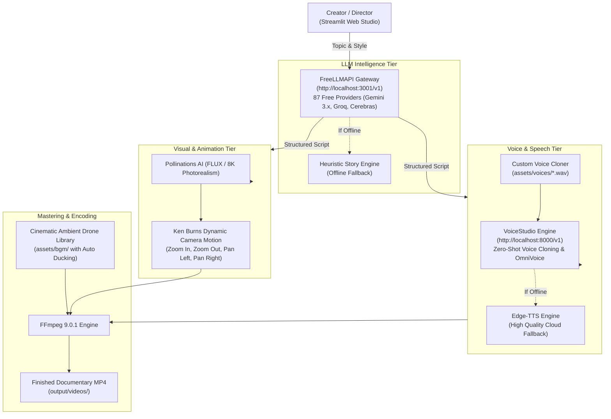

# 🎬 AI Voice Documentary Studio

**AI Voice Documentary Studio** is a unified, zero-cost AI documentary filmmaking pipeline combining:
1. **[FreeLLMAPI](file:///C:/Users/pyaae/Desktop/WorkSpace/freellmapi)** for zero-cost, multi-provider LLM intelligence (10B+ tokens/month across 87+ free providers with automatic failover).
2. **[VoiceStudio](file:///C:/Users/pyaae/Desktop/WorkSpace/VoiceStudio)** for zero-shot voice cloning, voice design, and offline narration across 646 languages.
3. **Cinematic Documentary Engine** for photorealistic visual generation (Pollinations FLUX), Ken Burns dynamic camera motion, timed subtitles, background audio ducking, and full 1080p MP4 rendering.

---

## Architecture & Integration Diagram



---

## Key Features

* **🧠 FreeLLMAPI Smart Router Integration**: Connects to `http://localhost:3001/v1` to script full documentaries across multiple scenes with zero API subscription cost and automatic failover.
* **🎙️ VoiceStudio Voice Cloning**:
  * Clone any real voice (e.g., Sir David Attenborough, Morgan Freeman, or your own voice) from a simple 5–30 second WAV audio sample.
  * Multi-narrator dialogue support: assign different voices to Lead Narrator, Historical Eyewitness, Explorer, or Scientist.
  * Transparent fallback to Edge-TTS when VoiceStudio is offline.
* **🎨 Photorealistic Visuals**:
  * Free, unlimited image generation via Pollinations AI (FLUX model).
  * 6 cinematic style presets: *Cinematic Photorealism*, *Historical 35mm Film Still*, *Space & Cosmic Odyssey*, *Dark Mystery & Crime Noir*, *Ancient Oil Painting*, *Cyberpunk Neon*.
* **🎥 Ken Burns Dynamic Motion**: Smooth pan and zoom camera transitions on every scene.
* **🎵 Audio Mastering & Vocal Ducking**: Cinematic ambient background music automatically ducks when narration begins.
* **📐 Flexible Formats**:
  * **16:9** Widescreen (YouTube / TV / Desktop)
  * **9:16** Vertical (TikTok / Instagram Reels / YouTube Shorts)
  * **2.39:1** Anamorphic Cinema Widescreen

---

## Quick Start (Windows)

### Option 1: Run with Launcher
Double click `run.bat` or run:
```powershell
.\run.bat
```

### Option 2: Run with Python
```powershell
cd C:\Users\pyaae\Desktop\WorkSpace\AI_Voice_Documentary_Studio
streamlit run app.py
```
Open **`http://localhost:8501`** in your browser.

---

## Workspace Layout

* [app.py](file:///C:/Users/pyaae/Desktop/WorkSpace/AI_Voice_Documentary_Studio/app.py): Streamlit web application.
* [config.py](file:///C:/Users/pyaae/Desktop/WorkSpace/AI_Voice_Documentary_Studio/config.py): Gateway URLs, resolution presets, and paths.
* [core/llm_gateway.py](file:///C:/Users/pyaae/Desktop/WorkSpace/AI_Voice_Documentary_Studio/core/llm_gateway.py): FreeLLMAPI client & token manager.
* [core/voice_studio_client.py](file:///C:/Users/pyaae/Desktop/WorkSpace/AI_Voice_Documentary_Studio/core/voice_studio_client.py): VoiceStudio audio client & voice cloner.
* [core/story_architect.py](file:///C:/Users/pyaae/Desktop/WorkSpace/AI_Voice_Documentary_Studio/core/story_architect.py): Documentary script planner.
* [core/visual_engine.py](file:///C:/Users/pyaae/Desktop/WorkSpace/AI_Voice_Documentary_Studio/core/visual_engine.py): Visual generation & style presets.
* [core/video_composer.py](file:///C:/Users/pyaae/Desktop/WorkSpace/AI_Voice_Documentary_Studio/core/video_composer.py): Ken Burns animation & FFmpeg mixer.
* [core/pipeline.py](file:///C:/Users/pyaae/Desktop/WorkSpace/AI_Voice_Documentary_Studio/core/pipeline.py): End-to-end production orchestrator.
